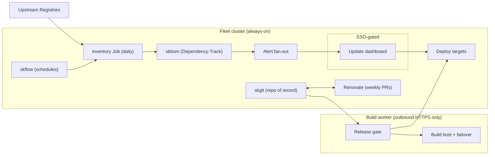

# skpatch-skworld-io

The static landing page for [skpatch.skworld.io](https://skpatch.skworld.io), served via GitHub Pages
directly from this repository's `index.html` and `CNAME`.

skpatch is SKWorld's patching program for a sovereign fleet: every container image pinned by
digest, inventoried daily, SBOM'd into Dependency-Track (`skbom`), and CVE-matched continuously.
Renovate opens the pin-bump pull requests, and a release gate proves every change before it ships:
same day for a critical finding with a fix on a reachable service, a weekly batch for the rest, and
a monthly review for the long tail. Host packages patch through the same discipline, one layer
down, via an SSO-gated update dashboard. See the [smilinTux/skpatch](https://github.com/smilinTux/skpatch)
repository for the implementation this site is grounded in.

## Component map

The interactive version, with trust boundaries, motion, and a dark/light toggle, is published at
[diagrams/skpatch.architecture.html](diagrams/skpatch.architecture.html) and linked from the live
site's [Architecture section](https://skpatch.skworld.io/#architecture). Two further diagrams cover
the data flow (inventory to SBOM to Dependency-Track to alerts/PRs to gate to deploy, sensitivity
labelled) and the release workflow (the same-day critical lane and the weekly batch lane), both
under [diagrams/](diagrams/).

## Diagrams

All three diagrams were authored as [Archify](https://github.com/tt-a1i/archify) JSON and built to
standalone, self-contained HTML (no CDN dependency beyond license/attribution links):

| Diagram | JSON source | Built HTML |
|---|---|---|
| Component map (architecture, trust boundaries) | `diagrams/skpatch.architecture.json` | `diagrams/skpatch.architecture.html` |
| Data flow (inventory → SBOM → Dependency-Track → alerts/PRs → gate → deploy) | `diagrams/skpatch.dataflow.json` | `diagrams/skpatch.dataflow.html` |
| Release lanes (same-day and weekly) | `diagrams/skpatch.workflow.json` | `diagrams/skpatch.workflow.html` |

## Docs viewer

`docs.html` renders `smilinTux/skpatch`'s `docs/*.md` live from the GitHub Contents API, with
`docs-manifest.json` as a committed offline fallback and a daily self-healing GitHub Action
(`.github/workflows/refresh-docs-manifest.yml`) to keep it in sync.

This site is part of the [SKWorld](https://skworld.io) sovereign AI ecosystem.

## License

MIT License, see [LICENSE](./LICENSE).
